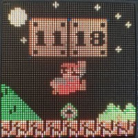

# Clockwise ESPHome - Retro Game Clocks for Home Assistant

[](https://esphome.io)
[](https://www.home-assistant.io)
[](LICENSE)

> Transform your HUB75 LED matrix into a retro game-inspired clock with Home Assistant integration! 🕐✨

This ESPHome component brings the fantastic [Clockwise](https://clockwise.page/) project to Home Assistant, featuring retro gaming clockfaces like Mario and Pac-Man with full remote control capabilities.





## ✨ Features

- **🎮 Retro Game Clockfaces**: Mario and Pac-Man themed clock displays
- **🏠 Home Assistant Integration**: Full control via Home Assistant dashboard
- **💡 Brightness Control**: Adjust display brightness (0-255) remotely
- **🌅 Automatic Brightness**: Optional LDR sensor for automatic brightness adjustment
- **🔄 Clockface Switching**: Change between clock styles on the fly
- **🎨 Panel Color Order**: Fix wrong colors without rewiring — swap R/G/B channels in software
- **⚡ Power Control**: Turn display on/off remotely
- **🎯 Huidu HD-WF2 Support**: Optimized for HD-WF2 boards with automatic pin mapping
- **📱 Real-time Sync**: Time synchronized with Home Assistant or NTP
- **🕐 Triple Time Sources**: Choose between Home Assistant, NTP (SNTP), or hardware RTC (BM8563)
- **🔄 RTC Sync**: One-click button to sync Home Assistant time to RTC hardware

## 🎯 Home Assistant Controls

The complete example configuration exposes these entities in Home Assistant (and in the device web UI when `web_server` is enabled):

- **Switch**: `display_power` - Turn display on/off
- **Switch**: `auto_brightness` - Enable/disable automatic brightness (when LDR is configured)
- **Number**: `display_brightness` - Adjust brightness (0-255)
- **Select**: `clockface` - Choose between Mario, Pac-Man, and other styles
- **Text**: `night_mode_start` and `night_mode_end` - Set Mario's night mode schedule as `HH:MM` in Home Assistant or the device web interface
- **Text**: `special_dates_input` - Configure recurring special-day messages for Mario and Pac-Man
- **Select**: `time_source` - Choose between Home Assistant, NTP, or RTC time
- **Select**: `panel_color_order` - Fix swapped colors by selecting RGB, RBG, GRB, GBR, BRG, or BGR
- **Button**: `sync_time_to_rtc` - Sync current Home Assistant time to RTC hardware
- **Sensor**: `ambient_light` - Current light level percentage (when LDR is configured)

Mario's night mode defaults to 20:00–06:00. Start is inclusive, end is exclusive, and equal times disable night mode. The settings persist across restarts and also support intervals that do not cross midnight.

Mario's special-day messages scroll across the top during the day. At night they scroll in warm cream over a darker version of the original brick ground at the bottom. Pac-Man replaces the date line with a pink scrolling greeting and adds a small red balloon roaming the maze corridors without consuming food.

### Night Mode Defaults and Persistence

The component accepts optional `night_mode_start` and `night_mode_end` settings in 24-hour `HH:MM` format, defaulting to `"20:00"` and `"06:00"`. These set the startup schedule, just like `initial_brightness` sets startup brightness; the Python schema itself does not persist UI edits.

The example and test configurations share each default between the component and its hidden persistent time entity using substitutions:

```yaml
substitutions:
  night_mode_start: "20:00"
  night_mode_end: "06:00"

clockwise_hub75:
  id: clockwise_main
  hub75_id: matrix_display
  night_mode_start: ${night_mode_start}
  night_mode_end: ${night_mode_end}

datetime:
  - platform: template
    type: time
    id: night_mode_start_time
    internal: true
    name: "Night Mode Start"
    optimistic: true
    restore_value: true
    initial_value: ${night_mode_start}
    on_value:
      - lambda: id(clockwise_main).set_night_start(x.hour * 3600 + x.minute * 60);
  - platform: template
    type: time
    id: night_mode_end_time
    internal: true
    name: "Night Mode End"
    optimistic: true
    restore_value: true
    initial_value: ${night_mode_end}
    on_value:
      - lambda: id(clockwise_main).set_night_end(x.hour * 3600 + x.minute * 60);
```

Merge these sections into existing YAML; use the visible `HH:MM` text controls from [the complete example](examples/clockwise.yaml) to edit them without seconds. Change the substitutions to customize defaults, rather than maintaining separate component/entity values. Saved UI values take precedence after reboot, so changing a YAML default does not overwrite an already saved schedule. Existing entity IDs are unchanged, preserving saved times.

ESPHome normally flushes preferences to flash every 60 seconds. Allow that interval after editing a saved setting before cutting power, or the latest edit may be lost.

### Special Days

In Home Assistant or the device web interface, edit **Special Dates (MM-DD:Name,...)**. Enter comma-separated dates and names, for example:

```text
03-23:Eric,12-24:Anna
```

On the matching date, both clockfaces scroll `Happy Birthday Eric!` from right to left. Mario also shows a balloon; Pac-Man uses the date area for the greeting and restores the date on ordinary days. Dates recur annually and use the currently selected time source and its timezone. This feature currently displays birthday greetings, not arbitrary message text.

- Up to 10 valid entries are used; names are truncated to 24 bytes.
- If multiple entries match today, the first one is used.
- The example text control accepts up to 220 characters. Commas separate entries and cannot be part of a name.
- Malformed entries are skipped with a warning in the logs. Month/day ranges are checked, but impossible calendar dates such as February 31 are not rejected.
- Clear the field to remove all special dates.

Both [the example configuration](examples/clockwise.yaml) and [the test configuration](testdevice.yaml) include the editable control and restore its saved value after reboot. To add it to an existing YAML, merge this entry into its existing `text:` list:

```yaml
text:
  - platform: template
    id: special_dates_input
    name: "Special Dates (MM-DD:Name,...)"
    icon: mdi:cake-variant-outline
    entity_category: config
    mode: text
    optimistic: true
    restore_value: true
    initial_value: ""
    min_length: 0
    max_length: 220
    set_action:
      - lambda: id(clockwise_main).set_special_dates(x);
```

Also add this action to the existing `esphome.on_boot` automation at priority `-100`, so the restored text is applied after initialization:

```yaml
- lambda: id(clockwise_main).set_special_dates(id(special_dates_input).state);
```

## 🏗️ Project Background

This project integrates the amazing [Clockwise](https://clockwise.page/) retro clock project by [jnthas](https://github.com/jnthas/clockwise) with Home Assistant using ESPHome. It leverages the excellent [HUB75 ESPHome component](https://github.com/stuartparmenter/hub75-esphome) by Stuart Parmenter to drive HUB75 LED matrices.

### Key Integration Points

- **Original Clockwise**: [clockwise.page](https://clockwise.page/) | [GitHub](https://github.com/jnthas/clockwise)
- **HUB75 Driver**: [hub75-esp32](https://github.com/stuartparmenter/hub75-esp32)
- **Hardware**: Optimized for Huidu HD-WF2 boards
- **Platform**: ESPHome with Home Assistant integration

## 🚀 Quick Start

### Prerequisites

**Hardware:**

- ESP32 development board (ESP32, ESP32-S3, or ESP32-S2)
- HUB75 RGB LED Matrix panel (64×32 or 64×64)
- Huidu HD-WF2 board (recommended) or compatible HUB75 driver board
- 5V power supply (adequate for your panel size)

**Software:**

- ESPHome installed (via Home Assistant or standalone)
- Home Assistant instance

### Installation

For a clock without Home Assistant, use the [standalone firmware and USB/Wi-Fi
setup guide](docs/standalone.md). Its [public configuration](examples/clockwise-standalone.yaml)
contains no personal credentials or shared API/OTA keys. It targets HD-WF2 with
a 64x64 FM6126A panel and Central European time.

1. **Clone this repository** or add as external component:

```yaml
external_components:
  - source: github://aschoelzhorn/clockwise-esphome@main
    components: [clockwise_hub75]
```

2. **Use the example configuration**:

Start with `examples/clockwise.yaml` and modify according to your hardware setup.

3. **Configure your secrets**:

Create a `secrets.yaml` file:

```yaml
wifi_ssid: "YourWiFiSSID"
wifi_password: "YourWiFiPassword"
api_encryption_key: "your-encryption-key"
wifi_ap_password: "fallback-hotspot-password"
```

The API encryption key must be a valid base64-encoded 32-byte key. OTA reuses this same key; no separate OTA password or key is needed.

4. **Flash to your ESP32**:

```bash
esphome run examples/clockwise.yaml
```

### Encrypted OTA Updates

The configurations use ESPHome OTA encryption instead of the legacy password, avoiding its additional flash/RAM cost:

```yaml
api:
  encryption:
    key: !secret api_encryption_key

ota:
  - platform: esphome
    encryption:  # Inherit the API key
```

This syntax is validated with ESPHome 2026.11.1. Keep the existing API key when migrating an installed device. Install from Device Builder/Desktop using ESPHome OTA, or use USB; do not use the device browser's firmware-upload endpoint.

Where the web UI is enabled, the configurations set `web_server.ota: false` so the normal web listener does not provide an unencrypted alternative to encrypted OTA. Settings remain available in the web UI; the captive portal retains its recovery upload path.

If older installed firmware still requires its legacy OTA password, use this **only for the migration upload**, keeping the old password in secrets:

```yaml
ota:
  - platform: esphome
    password: !secret ota_password
    encryption:
      allow_plaintext_upload: true
```

That explicitly permits the old upload protocol for this one install; the new firmware is still built for encrypted OTA. Once installed, remove `password` and `allow_plaintext_upload` and return to the encrypted-only block above. Do not leave plaintext fallback enabled. See [ESPHome's OTA documentation](https://esphome.io/components/ota/esphome/) for migration and key rotation.

## 🔧 Configuration

### Basic Configuration

```yaml
# I2C for RTC (required if using hardware RTC)
i2c:
  sda: 41
  scl: 42

# Time components
time:
  - platform: homeassistant
    id: homeassistant_time
    timezone: Europe/Vienna
  - platform: sntp               # Optional: NTP time source (no HA required)
    id: ntp_time
    timezone: Europe/Vienna
    servers:
      - 0.pool.ntp.org
      - 1.pool.ntp.org
      - 2.pool.ntp.org
  - platform: bm8563           # Optional: Hardware RTC for offline operation
    id: rtc_time
    address: 0x51

# HUB75 Display (using board preset for HD-WF2)
display:
  - platform: hub75
    id: matrix_display
    board: huidu-hd-wf2          # Automatic pin mapping
    panel_width: 64
    panel_height: 64
    shift_driver: FM6126A
    brightness: 128
    update_interval: 4294967295ms  # Never - clockwise handles updates
    rotation: 90 # (Optional, integer): The rotation of the display in degrees, one of 0, 90, 180 or 270. Defaults to 0

# Clockwise Component
clockwise_hub75:
  id: clockwise_main
  hub75_id: matrix_display
  clockface_type: MARIO          # Options: MARIO, PACMAN, DUNE, STARTREK
  panel_color_order: RGB         # Fix wrong colors: RGB, RBG, GRB, GBR, BRG, BGR
  initial_brightness: 128
  night_mode_start: "20:00"       # Startup defaults; see persistent controls above
  night_mode_end: "06:00"

esphome:
  on_boot:
    priority: 600
    then:
      - lambda: |-
          id(clockwise_main).set_ha_time(id(homeassistant_time));
          id(clockwise_main).set_ntp_time(id(ntp_time));
          id(clockwise_main).set_rtc_time(id(rtc_time));

# Home Assistant Controls
number:
  - platform: template
    id: display_brightness
    name: "Display Brightness"
    min_value: 0
    max_value: 255
    step: 1
    mode: slider
    lambda: return id(clockwise_main).get_brightness();
    set_action:
      - lambda: id(clockwise_main).set_brightness((uint8_t)x);

switch:
  - platform: clockwise_hub75
    clockwise_hub75_id: clockwise_main
    id: display_power
    name: "Display Power"

select:
  - platform: template
    id: clockface_selector
    name: "Clockface"
    options:
      - "Pacman"
      - "Mario"
      - "Dune"
      - "Star Trek"
    initial_option: "Pacman"
    restore_value: true
    optimistic: true
    on_value:
      then:
        - lambda: |-
            if (x == "Mario") id(clockwise_main).switch_clockface(esphome::clockwise_hub75::MARIO);
            else if (x == "Dune") id(clockwise_main).switch_clockface(esphome::clockwise_hub75::DUNE);
            else if (x == "Star Trek") id(clockwise_main).switch_clockface(esphome::clockwise_hub75::STARTREK);
            else id(clockwise_main).switch_clockface(esphome::clockwise_hub75::PACMAN);

  # Time source selector
  - platform: template
    id: time_source_selector
    name: "Time Source"
    options:
      - "Home Assistant"
      - "NTP"
      - "RTC"
    initial_option: "Home Assistant"
    restore_value: true
    optimistic: true
    on_value:
      then:
        - lambda: |-
            // 0 = Home Assistant, 1 = NTP, 2 = RTC
            int source = (x == "Home Assistant") ? 0 : (x == "NTP") ? 1 : 2;
            id(clockwise_main).set_time_source(source);

  # Panel color order - fix swapped colors without rewiring
  - platform: template
    id: panel_color_order_selector
    name: "Panel Color Order"
    icon: mdi:palette
    entity_category: config
    options:
      - "RGB"
      - "RBG"
      - "GRB"
      - "GBR"
      - "BRG"
      - "BGR"
    initial_option: "RGB"
    restore_value: true
    optimistic: true
    on_value:
      then:
        - lambda: |-
            esphome::clockwise_hub75::PanelColorOrder order = esphome::clockwise_hub75::RGB;
            if (x == "RBG") order = esphome::clockwise_hub75::RBG;
            else if (x == "GRB") order = esphome::clockwise_hub75::GRB;
            else if (x == "GBR") order = esphome::clockwise_hub75::GBR;
            else if (x == "BRG") order = esphome::clockwise_hub75::BRG;
            else if (x == "BGR") order = esphome::clockwise_hub75::BGR;
            id(clockwise_main).set_panel_color_order(order);

# Sync button (when RTC is configured)
button:
  - platform: template
    name: "Sync Time to RTC"
    icon: mdi:clock-check
    on_press:
      - bm8563.write_time:
          id: rtc_time
```

This basic snippet shows runtime control wiring. Use [the complete example](examples/clockwise.yaml) for persisted brightness, selectors, night times and special dates.

### Supported Hardware

**Tested Configurations:**

- **Huidu HD-WF2** + 64×64 FM6126A panel (recommended)
- ESP32-S3 DevKit + 64×64 panel

**Board Presets Available:**

- `huidu-hd-wf2` - Automatic pin mapping for HD-WF2 boards
- Manual pin configuration available for other boards

## 🎨 Available Clockfaces

### Mario Theme

- Classic Super Mario Bros. styling
- Animated blocks and character elements
- Custom Super Mario font
- Based on: [Original Mario Clockface (cw-cf-0x01)](https://github.com/jnthas/cw-cf-0x01)

### Pac-Man Theme

- Retro Pac-Man game aesthetics
- Yellow color scheme
- Classic arcade font styling
- Based on: [Original Pac-Man Clockface (cw-cf-0x05)](https://github.com/jnthas/cw-cf-0x05)

### Story Themes: Dune and Star Trek

- Select `DUNE` or `STARTREK`, or use the corresponding option in the complete example's Clockface selector.
- Both use a generic story orchestrator with themed acts, backgrounds, scrolling phrases and sprite events.
- Acts advance by elapsed time from activation using the theme's configured durations; switching away and back restarts the story.
- Build [the complete example](examples/clockwise.yaml) from the local checkout to use this branch's implementation. See [story build notes](components/clockwise_hub75/README.md#story-clockfaces) if a branch switch requires cleaning cached build files.

### Automatic Brightness Control (Optional)

The display can automatically adjust brightness based on ambient light using an LDR sensor:

```yaml
substitutions:
  enable_ldr: "true"  # Initial state on first boot
  ldr_pin: GPIO4
  ldr_update_interval: "2s"

sensor:
  - platform: adc
    pin: ${ldr_pin}
    name: "Ambient Light"
    id: ambient_light
    update_interval: ${ldr_update_interval}
    attenuation: 12db
    filters:
      - sliding_window_moving_average:
          window_size: 5
      - calibrate_linear:
          - 1.3 -> 0.0    # Dark voltage -> 0%
          - 3.0 -> 100.0  # Bright voltage -> 100%
    on_value:
      # Maps 0-100% light to 20-255 brightness
```

**Home Assistant Control**: Toggle auto-brightness on/off anytime using the `switch.auto_brightness` entity - no recompilation needed! The switch state persists across reboots and can be integrated into automations.

**Calibration**: Measure your LDR voltage range in dark/bright conditions and adjust the `calibrate_linear` values accordingly. See the full example in `examples/clockwise.yaml`.

### Planned Features

- **🎮 More Themes**: Additional retro game clockfaces
- **📊 Weather Display**: Weather information integration

## 🔌 Wiring Guide

For **Huidu HD-WF2** boards, no manual wiring needed - just use `board: huidu-hd-wf2` in your configuration.

**RTC Support**: The HD-WF2 board includes a BM8563 RTC chip connected via I2C. Configure it as a time source:

```yaml
i2c:
  sda: 41
  scl: 42

time:
  - platform: homeassistant
    id: homeassistant_time
  - platform: sntp
    id: ntp_time
    servers:
      - 0.pool.ntp.org
      - 1.pool.ntp.org
      - 2.pool.ntp.org
  - platform: bm8563
    id: rtc_time
    address: 0x51

esphome:
  on_boot:
    priority: 600
    then:
      - lambda: |-
          id(clockwise_main).set_ha_time(id(homeassistant_time));
          id(clockwise_main).set_ntp_time(id(ntp_time));
          id(clockwise_main).set_rtc_time(id(rtc_time));

# Time source selector
select:
  - platform: template
    id: time_source_selector
    name: "Time Source"
    options:
      - "Home Assistant"
      - "NTP"
      - "RTC"
    initial_option: "Home Assistant"
    on_value:
      - lambda: |-
          // 0 = Home Assistant, 1 = NTP, 2 = RTC
          int source = (x == "Home Assistant") ? 0 : (x == "NTP") ? 1 : 2;
          id(clockwise_main).set_time_source(source);

# Sync button to write HA time to RTC
button:
  - platform: template
    name: "Sync Time to RTC"
    icon: mdi:clock-check
    on_press:
      - bm8563.write_time:
          id: rtc_time
```

**Why NTP?** NTP provides accurate time directly from internet time servers without requiring a Home Assistant connection — ideal if you want the clock to work standalone.

**Why RTC?** An RTC maintains accurate time even when WiFi is unavailable, making your clock more reliable. 

For custom setups, see the [original HUB75 ESPHome component](https://github.com/stuartparmenter/hub75-esphome).

## 🏠 Home Assistant Dashboard

Add this card to your dashboard:

```yaml
type: entities
entities:
  - entity: select.clockwise_hdwf2_clockface
    name: Clockface
  - entity: select.clockwise_hdwf2_time_source
    name: Time Source
  - entity: select.clockwise_hdwf2_panel_color_order
    name: Panel Color Order
  - entity: button.clockwise_hdwf2_sync_time_to_rtc
    name: Sync Time to RTC
  - entity: number.clockwise_hdwf2_display_brightness
    name: Display Brightness
  - entity: switch.clockwise_hdwf2_display_power
    name: Display Power
  - entity: switch.clockwise_hdwf2_auto_brightness
    name: Auto Brightness
  - entity: update.clockwise_clock_firmware
    name: Firmware
title: Clockwise HD-WF2 Clock
```

## 🔧 Technical Details

### Implementation Notes

This ESPHome component adapts the original Clockwise codebase with these key changes:

- **File Structure**: Flattened directory structure (ESPHome limitation)
- **Include Paths**: Modified to use local includes (`"file.h"` vs `<file.h>`)
- **DateTime Integration**: Custom `CWDateTime.cpp` implementation for ESPHome time sync
- **Component Architecture**: Wrapper around original Clockwise rendering code

### Performance Considerations

- **ESP32-S3**: Recommended for higher refresh rates (120+ Hz)
- **ESP32**: Works well at 60-80 Hz refresh rates
- **Memory Usage**: Optimized with `-Os` compile flag
- **Power Efficiency**: Configurable brightness for power management

## 📚 Troubleshooting

### Common Issues

**Display is blank:**

- Check power supply (5V, adequate current)
- Verify wiring connections
- Verify shift driver setting (`FM6126A` vs `GENERIC`)

**Wrong colors:**

- Use the **Panel Color Order** select in Home Assistant to swap channels in software — try `RBG`, `GRB`, `BGR`, etc. until colors look correct. No rewiring needed.
- If none of the six options fix it, check the physical RGB pin connections on your board.

**Boot loops:**

- Disconnect HUB75 during ESP32 boot
- Use board presets to avoid strapping pin conflicts
- Check power supply stability

### Getting Help

- **Issues**: [GitHub Issues](https://github.com/aschoelzhorn/clockwise-esphome/issues)
- **ESPHome**: [ESPHome Discord](https://discord.gg/KhAMKrd)
- **Home Assistant**: [Community Forum](https://community.home-assistant.io)

## 📄 License

This project is licensed under the MIT License - see the [LICENSE](LICENSE) file for details.

### Acknowledgments

- **[Clockwise](https://github.com/jnthas/clockwise)** by jnthas - Original retro clock implementation
- **[HUB75-ESP32](https://github.com/stuartparmenter/hub75-esp32)** by Stuart Parmenter - HUB75 driver library
- **[ESPHome](https://esphome.io)** - Home automation platform
- **[Home Assistant](https://www.home-assistant.io)** - Home automation hub

## 🤝 Contributing

Contributions are welcome! Please feel free to submit a Pull Request.

1. Fork the repository
2. Create a feature branch (`git checkout -b feature/AmazingFeature`)
3. Commit your changes (`git commit -m 'Add some AmazingFeature'`)
4. Push to the branch (`git push origin feature/AmazingFeature`)
5. Open a Pull Request

## 🚧 Development Status

This project is maintained and tested with the hardware configurations listed above. New features and clockfaces are continuously being developed.

**Current Status**: Stable for Mario and Pac-Man clockfaces with optional auto-brightness support
